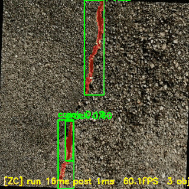
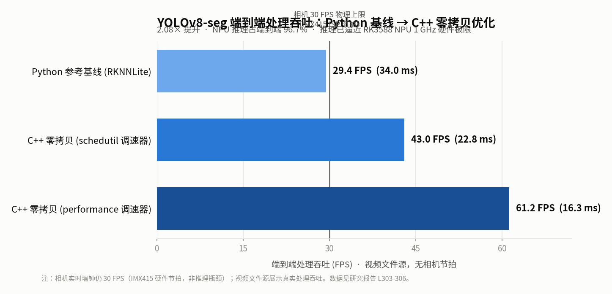
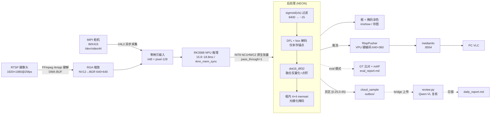
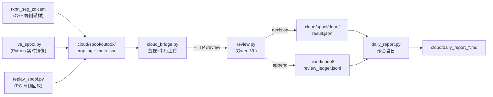

# YOLOv8-seg 裂缝实例分割 · RK3588 NPU 零拷贝端侧部署

> YOLOv8-seg（32 通道掩码系数 + 原型掩码）单类裂缝实例分割，从训练到 RK3588 板端 INT8 部署的全流程工程。
> 通过 ONNX 图手术（cut-tail）解决 INT8 量化置信度全零，用 RKNN C API 零拷贝 + ARM NEON + filter-first 把推理-后处理压到 NPU 主导（占端到端 96.7%）。
>
> **支持两种输入路径**：MIPI 相机（低延迟本地）和 RTSP 网络摄像头（远程、可多路）。可选云端 VLM 灰区复核。
本项目面向基础设施裂缝巡检场景，在 RK3588 边缘 NPU 上部署单类裂缝实例分割模型，实现从视频采集到分割结果输出的全链路实时处理。针对 YOLOv8-seg 直接 INT8 量化后置信度全零的问题，采用 ONNX cut-tail 图手术将 DFL、Sigmoid、框解码等量化敏感算子移出量化图，仅保留纯卷积量化；结合 RKNN C API 零拷贝直通、NEON 融合点积、filter-first 后处理、框内 4×4 光栅化，将推理与后处理压缩至 NPU 主导，软件开销低于 0.6 ms。系统同时支持 MIPI 相机与 RTSP 网络摄像头两种输入，并可选用 云端 VLM 灰区复核对低置信检测做二次判定，形成端云协同的完整闭环。
---

## 目录

- [项目展示](#showcase)
- [快速开始（新手 5 分钟跑通）](#quickstart)
- [一、效果定位](#positioning)
- [二、架构图](#architecture)
- [三、两种输入路径](#inputs)
- [四、环境与依赖](#environment)
- [五、一键复现](#reproduce)
- [六、局限与诚实声明](#limitations)
- [七、云端 VLM 复核（灰区二次判定，可选增值）](#cloud-vlm)
- [附录 A：模型文件注册表](#appendix-a)
- [附录 B：后处理阈值清单](#appendix-b)
- [附录 C：源码索引](#appendix-c)
- [FAQ](#faq)

---

<a id="showcase"></a>
## 项目展示

### 端到端效果

`rknn_seg_zc demo` 模式（S4）：视频文件 / 图像目录 → 零拷贝推理 + filter-first 后处理 → 框 + 4×4 掩码涂色 + OSD → 写 mp4/gif。**刻意避开相机 30 FPS 节拍**，展示真实处理吞吐。

**实测演示**（50 张裂缝图像目录 → `demo_imgs.mp4`，再做 `demo_small.gif`）：



> 平均置信度 **0.785**，处理吞吐 **60.2 FPS**（OSD 实时显示）。GIF 80 帧 / 10s / 1.9 MB。

### 性能对比图

**端到端吞吐对比**（crack 单类模型；分两个口径：**视频源稀疏场景** = 原叙事口径，**200 val 密集场景** = 几乎张张有裂缝的后处理密集口径）：



### 核心数字

| 指标 | 值 | 说明 |
|---|---|---|
| **NPU 推理** | **15.8 ms** | PERF_RUN 单帧实测（MIPI 路径）；RTSP 路径 18.8 ms |
| **视频文件源吞吐** | **61.2 FPS** | MIPI 路径，视频文件源 |
| **RTSP 端到端处理** | **46.1 FPS** | FFmpeg 硬解 + RGA + NPU，500 帧 bench |
| **RTSP 全循环** | **24.0 FPS** | 受摄像头 25fps 节拍限制 |
| **模型大小** | **4.5 MB** | INT8 cut-tail（原 ONNX 13 MB） |
| **板端 Box mAP50** | **0.809** | 200 val 图，C++ eval 模式 |
| **板端 Mask mAP50** | **0.626**（C++ 实时）/ **0.669**（160 口径） | 训练机 0.666 |
| **云端复核** | **225 条 / 94.2% ok / 0.07 元** | qwen3.5-flash VLM |
| **全流程 CPU** | **194%**（cam 185%） | 含推流 + 云端协同 |
| **温度** | **34.4°C** | 10 分钟持续运行 |

### 关键设计

| 设计 | 作用 |
|---|---|
| **cut-tail 图手术** | 把 DFL/Sigmoid/框解码移出量化图，解决 INT8 塌零 |
| **零拷贝直通** | rknn_create_mem + pass_through，消除拷贝和反量化 |
| **int8 域后处理** | filter-first + NEON 融合点积 + 框内 4×4 光栅化 |
| **DMA-BUF 链路** | VPU → RGA → NPU 全程 fd 传递，CPU 不搬数据 |
| **灰区协同** | 端侧只报 [0.25, 0.45)，云端 VLM 兜底 |
| **异步旁路** | 云端协同不阻塞主推理 |

---

<a id="quickstart"></a>
## 快速开始（新手 5 分钟跑通）

### 你需要准备

| 类别 | 具体 | 必需 |
|---|---|---|
| 板子 | RK3588（如 ATK-DLRK3588） | ✅ |
| 摄像头 | MIPI 相机（IMX415）**或** RTSP 网络摄像头 | ✅ 二选一 |
| 屏幕 | HDMI 显示器 或 MIPI 屏 | 推荐 |
| 网络 | 板子能连 WiFi（RTSP 路径必需） | RTSP 必需 |
| PC | Ubuntu（交叉编译 + 云端服务可选） | ✅ |

### 三步跑通

**第一步：下载代码和模型**

```bash
git clone https://github.com/Telepath-LXR/rk3588-yolov8-seg-crack.git
cd rk3588-yolov8-seg-crack
```

**第二步：推到板子**

```bash
adb push yolo8n_int8_cut.rknn /yolo8/
adb push rknn_seg_zc          /yolo8/
```

**第三步：跑一条命令**

```bash
# MIPI 相机
adb shell "cd /yolo8 && LD_LIBRARY_PATH=/usr/lib ./rknn_seg_zc cam yolo8n_int8_cut.rknn /dev/video44"

# RTSP 摄像头（先改成你的 RTSP URL）
adb shell "cd /yolo8 && LD_LIBRARY_PATH=/opt/ffmpeg-rkmpp/lib ./rknn_seg_zc cam yolo8n_int8_cut.rknn 'rtsp://admin:密码@摄像头IP:554/Streaming/Channels/101'"
```

### 看到什么算成功

- 板子屏幕出现摄像头画面
- 画面上有绿色框 + 红色掩码
- 左上角显示 `[ZC] run XXms post XXms XXFPS`

**就成功了。**

### 跑不起来？看 [FAQ](#faq)

---

<a id="positioning"></a>
## 一、效果定位

一句话：**把 YOLOv8-seg 在 RK3588 上的推理-后处理路径优化至主要耗时位于 NPU 执行阶段（NPU 占端到端 96.7%），精度与 Python 参考对齐，为端侧视觉感知提供高吞吐、低延迟、零拷贝前端。**

三个关键数字：

- **15.8 ms** —— NPU 推理占端到端 96.7%，软件开销 <0.6 ms；在当前模型/输入/单核配置下，处理链路主要耗时位于 NPU 执行阶段。
- **61 FPS** —— 视频文件源端到端处理吞吐（非相机实时）；相机实时 30 FPS 是 IMX415 硬件节拍上限，不是推理瓶颈。**RTSP 路径全循环 24 FPS**，同样受摄像头 25fps 节拍限制。
- **0.809 / 0.626** —— 板端 INT8 mAP，与训练机 0.833/0.666 对照（Box −2.4 个百分点；Mask 多口径接近，C++ 实时 −4.0 个百分点，归因于 4×4 光栅化，未单独隔离量化影响）。
- **0.65 ms 后处理（单类口径）** —— 真实 COCO 80 类对照下同管线 8.8ms：单类省 7.9ms（全在 cls 收集段），真优化（光栅化 0.14ms/零拷贝/filter-first）与类数无关。见 [`eval_results/single_class_bonus.md`](eval_results/single_class_bonus.md)。

---

<a id="architecture"></a>
## 二、架构图



ASCII 版（无 mermaid 渲染时）：

```
【路径 A：MIPI 相机】
IMX415 →[V4L2 async]→ 零拷贝输入(int8=pixel-128)

【路径 B：RTSP 摄像头】
RTSP(1920×1080@25fps) →[FFmpeg rkmpp 硬解]→ DMA-BUF(NV12)
                                          →[RGA 缩放]→ BGR 640×640
                                          → 零拷贝输入

                          ↓ 汇合
          RK3588 NPU 推理 15.8~18.8ms (rknn_create_mem/set_io_mem/mem_sync)
                           │  INT8 NC1HWC2 原生张量, pass_through=1
                           ▼
   filter-first 后处理 0.6~2.9ms ──┬── sigmoid(cls) 过滤 8400→~15
                                   ├── DFL + box 解码 (仅幸存锚点)
                                   ├── dot16_i8f32 (融合 int8×float32 点积)
                                   └── 框内 4×4 memset 光栅化
                           │
                           ▼
          ┌────────────────┴────────────────┐
          ▼                ▼                ▼
      本地显示         推流到 PC         灰区采样
     (Weston)      (mediamtx→VLC)     (outbox/)
                                          │
                                          ▼
                                  cloud_bridge.py → review.py
                                  (Qwen-VL 复核) → daily_report.md
```

优化链路（每条都是"问题 → 手段 → 结果"）：

1. **ONNX cut-tail 图手术** —— INT8 把 DFL/Sigmoid/decode 量化塌掉致置信度全零 → 删 31 个尾部敏感算子、10 个原始 Conv 分支输出 → INT8 只碰 Conv → "INT8 速度 + FP32 精度"。额外修复：cut 导出漏了 proto SiLU，手动补回 Sigmoid+Mul（详见 [ALIGNMENT_NOTES](eval_results/ALIGNMENT_NOTES.md)）。
2. **零拷贝原生张量** —— `rknn.inference()` 的 numpy↔NPU 拷贝 + 自动反量化慢 → `rknn_create_mem/set_io_mem/mem_sync` + `pass_through=1` 直接吃 NPU 原生 int8 → 推理 24.9→16.0 ms。
3. **NEON 融合点积 `dot16_i8f32`** —— proto 全量反量化浪费 → 直接吃原生 int8 proto，反量化融进点积累加（C2=16 连续，一次 `vld1_s8`）→ 省全量反量化。
4. **filter-first** —— 8400 锚点全算 DFL（每锚点 64 次 softmax）是浪费 → 先 sigmoid(cls) 过滤到 ~15 个幸存锚点再重活 → DFL 工作量降 ~560×。掩码合成跳过 sigmoid（`sigmoid(x)>0.5 ⟺ x>0`）。
5. **框内 4×4 memset 光栅化** —— 160→640 双线性 `cv2.resize` 慢 → 框内直接 4×4 块 memset → 省中间 Mat + resize，后处理 9.1→0.6 ms。
6. **CPU performance 调速器** —— schedutil 抖动 → 8 核全设 performance → NPU run ~19→15.8 ms（最廉价单一优化）。
7. **RTSP 硬解 + RGA + 推流（2026-10-14 新增）** —— 远程摄像头接入 → FFmpeg rkmpp 硬解 + DMA-BUF 零拷贝 + RGA 缩放，VPU 硬编码推流到 mediamtx，PC VLC 低延迟观看。

---

<a id="inputs"></a>
## 三、两种输入路径

### 3.1 MIPI 相机（短距离、低延迟）

```bash
# 直接拉 /dev/video44
./rknn_seg_zc cam yolo8n_int8_cut.rknn /dev/video44
```

**特点**：延迟 <10ms，无需解码，适合本地检测。当前 IMX415 锁 30fps，是相机硬件节拍。

### 3.2 RTSP 网络摄像头（远程、可多路）

```bash
# 拉 RTSP 流
./rknn_seg_zc cam yolo8n_int8_cut.rknn \
  "rtsp://admin:密码@摄像头IP:554/Streaming/Channels/101"
```

**特点**：

- 摄像头可装远处，板子放机房
- 需要 **FFmpeg rkmpp 硬解**（板子上需部署 `/opt/ffmpeg-rkmpp/`）
- 支持 **RTSP 推流到 mediamtx**，PC VLC 拉流观看（`rtsp://<板子IP>:8554/live`）
- 延迟 200~500ms（摄像头编码缓冲 + VLC 缓冲）
- 详细配置见 [`docs/RTSP_SETUP.md`](docs/RTSP_SETUP.md)（待补）

**RTSP 链路实测性能**：

| 阶段 | 耗时 | 备注 |
|---|---|---|
| VPU 硬解（h264_rkmpp） | CPU 6% | 1080p@25fps |
| RGA 缩放（1920×1080→640×640） | <1ms | DMA-BUF 零拷贝 |
| NPU 推理 | 18.8 ms | 比 MIPI +3ms（RGA 争带宽） |
| 后处理 | 2.9 ms | 有裂缝场景掩码合成 |
| **端到端处理** | **21.7 ms / 46.1 FPS** | — |
| **全循环** | **41.6 ms / 24.0 FPS** | 受摄像头 25fps 节拍 |

### 3.3 一键启停脚本

```bash
# 启动全流程（Weston + mediamtx + review + bridge + cam）
/yolo8/start_all.sh start

# 停止
/yolo8/start_all.sh stop

# 查看状态
/yolo8/start_all.sh status

# 重启
/yolo8/start_all.sh restart
```

**首次使用需填 `DASHSCOPE_API_KEY` 环境变量**：

```bash
export DASHSCOPE_API_KEY=sk-ws-...
/yolo8/start_all.sh start
```

脚本见 [`start_all.sh`](start_all.sh)。

---

<a id="environment"></a>
## 四、环境与依赖

### 硬件

- **板端**：RK3588（3 核 NPU @ 1 GHz，8 GB 内存）
  - MIPI 路径：IMX415 摄像头（`/dev/video44`）
  - RTSP 路径：任意支持 RTSP 的 IP 摄像头
- **训练机**：Windows + NVIDIA GPU（仅训练，非部署）

### 板端运行依赖

| 依赖 | 版本 | 说明 |
|---|---|---|
| librknnrt.so | RKNN Toolkit2 runtime | 板端 NPU C API，sysroot 自带 |
| OpenCV | 4.9.0 | highgui/imgcodecs/imgproc/videoio/core |
| FFmpeg + rkmpp | 8.1.2 | **RTSP 路径必需**，见 `docs/RTSP_SETUP.md` |
| mediamtx | 1.9.3 | **推流路径必需** |
| RKNNLite (Python) | 板端自带 | 仅 Python 参考/eval 路径用 |
| Python | 3.11 | 板端自带（云端协同 + eval 用） |

### 交叉编译工具链

- **buildroot aarch64 g++ 13.4.0**：`atk_dlrk3588_linux6.1/buildroot/output/alientek_rk3588/host/bin/aarch64-buildroot-linux-gnu-g++`
- **sysroot**：含 librknnrt.so + opencv4 头/库
- 见 [`build_zc.sh`](build_zc.sh)

### 模型转换工具链（PC 侧）

- **rknn-toolkit2 v2.3.2**（conda env `rknn2`，`anaconda3/envs/rknn2/bin/python3`）
  - ⚠️ **必须用 `rknn2` 环境**。`pytorch` 环境（toolkit v1.5.2）对 cut-tail ONNX 会触发 `onnxoptimizer` segfault。
- **onnxruntime 1.19.2**（host FP32 参考验证用）
- **ultralytics**（训练 + val 参考）

---

<a id="reproduce"></a>
## 五、一键复现

### 1. 交叉编译 C++ 推理程序

```bash
cd /yolo8-seg
bash build_zc.sh          # 产出 aarch64 ELF: rknn_seg_zc
```

### 2. 部署到板端（adb 已连接）

```bash
adb push rknn_seg_zc            /yolo8/
adb push yolo8n_int8_cut.rknn   /yolo8/
adb push post_cut.py            /yolo8/    # Python 参考/eval 用
adb push eval_py.py             /yolo8/
adb push start_all.sh           /yolo8/    # 一键启停（RTSP 路径用）
```

### 3. 板端运行（先设 performance 调速器）

```bash
# 8 核全设 performance (NPU run ~19→15.8ms, 最廉价优化)
for i in 0 1 2 3 4 5 6 7; do
  adb shell "echo performance > /sys/devices/system/cpu/cpu$i/cpufreq/scaling_governor"
done

adb shell
cd /yolo8
export LD_LIBRARY_PATH=/usr/lib:$LD_LIBRARY_PATH

# 静态图推理 (精度回归)
./rknn_seg_zc image yolo8n_int8_cut.rknn test_frame.png

# 相机实时显示
./rknn_seg_zc cam   yolo8n_int8_cut.rknn /dev/video44

# 相机 benchmark (300 帧)
./rknn_seg_zc bench yolo8n_int8_cut.rknn /dev/video44 300

# 视频吞吐 (无相机节拍, 展示真实 61 FPS)
./rknn_seg_zc bench yolo8n_int8_cut.rknn /oem/SampleVideo_1280x720_5mb.mp4 300

# RTSP 硬解路径 (需先部署 FFmpeg rkmpp)
export LD_LIBRARY_PATH=/opt/ffmpeg-rkmpp/lib:$LD_LIBRARY_PATH
./rknn_seg_zc bench yolo8n_int8_cut.rknn "rtsp://admin:密码@摄像头IP:554/Streaming/Channels/101" 500

# demo 生成可视化 (视频文件或图像目录 → 涂色+OSD mp4)
./rknn_seg_zc demo  yolo8n_int8_cut.rknn /oem/SampleVideo_1280x720_5mb.mp4 demo_video.mp4
./rknn_seg_zc demo  yolo8n_int8_cut.rknn datasets/crack-seg/images/val    demo_imgs.mp4

# 板端 mAP 评测 (eval 模式, 需 datasets/crack-seg)
./rknn_seg_zc eval  yolo8n_int8_cut.rknn /path/to/crack-seg val
#   → 生成 eval_report.md (Box/Mask mAP50/mAP50-95/recall/miss/IoU + 失败样例)

# Python 双线性参考 (隔离 4×4 光栅化对 mask mAP 的影响)
python3 eval_py.py yolo8n_int8_cut.rknn /path/to/crack-seg val
```

`rknn_seg_zc` 模式总览：

| 模式 | 命令 | 用途 |
|---|---|---|
| `image` | `image <model> ` | 单图推理 + 可视化，精度回归 |
| `cam` | `cam <model> [src]` | 相机实时显示；`src` 可为 `/dev/videoX` 或 RTSP URL |
| `bench` | `bench <model> [src] [N]` | N 帧基准，打印推理/后处理/FPS |
| `demo` | `demo <model> <video_or_dir> [out.mp4]` | 视频文件/图像目录 → mp4，避开相机节拍展示真实吞吐（S4） |
| `eval` | `eval <model> <dataset_dir> [split]` | val 集 mAP 评测，生成 `eval_report.md` |

环境变量：`CORE_MASK=0|1|3|7|0xffff` 覆盖 NPU 核心掩码（默认 `CORE_0`，小模型单核已饱和）；`EVAL_DEBUG=1` 打印 eval 逐图调试；`CLOUD_SPOOL_DIR` 指定 C++ 灰区采样输出目录。

### 4. 模型转换（从 ONNX 重建 .rknn，可选）

```bash
# 用 rknn2 环境 (不是 pytorch!)
/anaconda3/envs/rknn2/bin/python3 convert_cut.py
#   读 yolo8n_cut.onnx → INT8 量化 (50 张校准图 quant.txt) → yolo8n_int8_cut.rknn
```

---

<a id="limitations"></a>
## 六、局限与诚实声明

**如实报告，未为好看调数字。**

1. **相机 30 FPS 是真天花板，不是推理瓶颈。** 用 `RKNN_QUERY_PERF_RUN` 分离出 NPU 计算 15.77 ms（单帧实测，相机/视频稀疏源；eval 200 图密集口径 mean 16.08ms）、软件开销 <0.6 ms（NPU 占端到端 96.7%），处理链路主要耗时位于 NPU 执行阶段。墙钟 FPS 受 IMX415 ISP 30 FPS 节拍限制。视频文件源可跑到 61 FPS 展示真实吞吐。**RTSP 摄像头锁 25fps**，全循环同样受限。**10 分钟 / 36000 帧持续推理验证**：120 个频率采样点（每 5 s）均记录 1 GHz，逐帧延迟 p99=17.8 ms / max=18.3 ms 无持续抬升；NPU 热区峰值 37.9 °C 远低于固件临界点 115 °C（详见 [`eval_results/`](eval_results/)）。注意：5 s 采样覆盖采样点而非逐帧，结论由采样 + 逐帧延迟分布交叉支持。

2. **单类（crack）。** cls 通道=1 硬编码。**后处理 0.6ms 是单类口径**：真实 COCO 80 类对照（官方 yolov8n-seg 走同一 cut-tail + 零拷贝管线，同板同调速器）后处理 **8.5-8.8ms / 37 FPS**——单类省 ~7.9ms（≈92%），几乎全部来自 cls 收集段（8400 锚点 × 80 类 vs ×1 的固定扫描，与检出数无关）。真优化（光栅化 0.14ms、filter-first NMS≈0、零拷贝）与类数无关、对多类同样有效，80 类口径仍满足相机 30 FPS 节拍。分解见 [`eval_results/single_class_bonus.md`](eval_results/single_class_bonus.md)。

3. **Mask mAP 的 4×4 光栅化折中。** C++ 实时路径用框内 4×4 块 memset（最近邻）+ 416 分辨率 IoU 换取相机实时路径的实时性，Mask mAP50 = 0.626 vs 训练机 0.666（−4.0 个百分点）。多口径接近不能单独隔离 INT8 量化的影响——分辨率、插值、评测实现均不同；这里只能观察到"同 INT8 模型在不同口径下结果接近"，更多口径对照见 [`eval_results/ALIGNMENT_NOTES.md`](eval_results/ALIGNMENT_NOTES.md)。

4. **Box mAP −2.4 个百分点（0.833→0.809）= INT8 量化预期代价。** cut-tail 已把 DFL/Sigmoid/box 解码移出量化图（仅 Conv 量化），影响小但非零。**自洽性说明**：Box 与 Mask 共享同一 INT8 Backbone，Box 的 −2.4pt 量化损失对 Mask 分支理应也存在——160 口径 Mask 与训练机持平（0.669 vs 0.666）可能是量化损失被分辨率口径差异（160 vs 训练机原生）抵消/掩盖，而非"INT8 对 mask 无损"。Box 缺 160 口径对照，无法单独分离两者——这是归因的已知边界。

5. **训练轻微过拟合。** Box/Mask mAP 峰值在 epoch 84-90，之后波动下行至 184（patience=100 早停触发）。`best.pt` 保存峰值权重。这是 YOLOv8n-seg 小模型 + 细长裂缝的典型上限，非实现错误。

6. **RTSP 路径的延迟三重缓冲（2026-10-14 实测）**。端到端延迟约 200~500ms，来自：摄像头编码缓冲 + 网络传输 + VLC 网络缓冲（默认 1000ms，可调 `--network-caching=100`）。**不是代码问题，是 RTSP 协议固有特性**。降低延迟需从摄像头编码配置（I 帧间隔 25、平滑等级 1、Profile Baseline）和 VLC 缓冲参数入手。

---

<a id="cloud-vlm"></a>
## 七、云端 VLM 复核（灰区二次判定，可选增值）

> **定位**：端侧 INT8 分割对低置信**灰区** `[OBJ_THRESH=0.25, CLOUD_HI=0.45)` 的检测框采样上传，云端 Qwen-VL 复核，回写 `upgrade`/`downgrade`/`human_queue`/`keep_edge` 决策，`daily_report` 聚合。**这是端侧主流程之上的可选纵向增值，非本项目核心交付**——端侧分割推理链路独立成立，不依赖云端。

### 数据流



### 文件清单（`cloud/` 子目录）

| 文件 | 作用 |
|---|---|
| [`cloud/live_spool.py`](cloud/live_spool.py) | 板端相机实时灰区采样，`rknn_seg_zc.cpp::cloud_sample` 的 Python 镜像 |
| [`cloud/replay_spool.py`](cloud/replay_spool.py) | PC 离线用 `best.pt` 跑 val 集模拟灰区采样，无板子时打通云端链路 |
| [`cloud/cloud_bridge.py`](cloud/cloud_bridge.py) | 端侧上传守护进程：监视 `outbox/`，串行 POST 到 `/review`，限流/重试/磁盘水位 |
| [`cloud/review.py`](cloud/review.py) | 最薄复核代理：鉴权 + 限流 + 预算 + prompt 组装 + Qwen-VL 调用 + JSON 校验 + ledger 记账 |
| [`cloud/daily_report.py`](cloud/daily_report.py) | 扫 `done/` 聚合当日复核事件 → Markdown 日报 |
| [`cloud/run_pipeline.sh`](cloud/run_pipeline.sh) | 一键驱动脚本 |
| [`cloud/mediamtx.yml`](cloud/mediamtx.yml) | mediamtx 配置（含 cam path 直接 pull 摄像头） |
| [`start_all.sh`](start_all.sh) | 全流程一键启停（Weston + mediamtx + review + bridge + cam） |
| [`cloud/spool/review_ledger.jsonl`](cloud/spool/review_ledger.jsonl) | **评审证据**：真实 Qwen-VL 复核记录 |

### 现有证据（2026-10-14 更新）

`cloud/spool/review_ledger.jsonl` 已有 **225 条真实 Qwen-VL（`qwen3.5-flash`）复核记录**：

| 状态 | 数量 | 占比 |
|---|---|---|
| **status: ok** | **212** | **94.2%** |
| status: APIConnectionError | 13 | 5.8%（网络抖动，bridge 自动重试） |

**决策分布**：

| 决策 | 数量 | 占比 |
|---|---|---|
| **downgrade**（VLM 判定误检） | **150** | **66.7%** |
| human_queue（待人工） | 50 | 22.2% |
| keep_edge（保持原判） | 25 | 11.1% |
| upgrade（VLM 确认漏检） | 0 | — |

**总费用：0.0708 元**（单条 ~0.00031 元）。

**VLM 判定示例**（部分）：

| 端侧conf | VLM 判定 | 理由 |
|---|---|---|
| 0.430 | no (0.85) | 线条过于笔直均匀，缺乏裂缝的不规则性和深度感 |
| 0.349 | no (0.90) | 画面主体为横贯的黑色线缆或管道 |
| 0.224 | no (0.95) | 图像显示为人物面部特写，非建筑结构表面 |
| 0.190 | no (0.95) | 画面主要为白色墙面及前景遮挡物（头发） |
| 0.448 | uncertain (0.50) | 图像极度模糊，无法分辨纹理与深度 |

> **以下调为主**——低置信灰区中近三分之二被 VLM 判为非裂缝误检（阴影/线缆/污渍等），与灰区"拿不准才送云"的定位一致。

### 运行

```bash
# A. 一键启动全流程（含云端）
export DASHSCOPE_API_KEY=sk-ws-...
/yolo8/start_all.sh start

# B. 或手动分步启动
./cloud/run_pipeline.sh serve                          # 终端1：启云端复核服务
./cloud/run_pipeline.sh bridge                         # 终端2：启上传守护
./cloud/run_pipeline.sh camera yolo8n_int8_cut.rknn /dev/video44  # 终端3：相机实时

# C. 仅生成日报
./cloud/run_pipeline.sh report          # 当日
./cloud/run_pipeline.sh report --all     # 历史全部
```

### 环境变量

| 变量 | 作用 | 默认 |
|---|---|---|
| `DASHSCOPE_API_KEY` | 云端 VLM 鉴权（必需） | — |
| `SPOOL_DIR` | spool 根目录 | `spool` |
| `CLOUD_SPOOL_DIR` | C++ 端侧 outbox 根 | `spool` |
| `CLOUD_HI` / `CLOUD_CONF_HI` | 灰区上界 | `0.45` |
| `OBJ_THRESH` | 灰区下界 | `0.18` / **0.25**（RTSP 实测） |
| `DEVICE_TOKEN` / `TOKENS_JSON` | 上传鉴权 token | `test-token` |
| `DAILY_BUDGET_YUAN` | 每日预算上限 | `10.0` |
| `CLOUD_ENDPOINT` | review 服务 URL | `http://localhost:8000/review` |

### 诚实声明

1. **`cost_yuan` 为估算，非真实账单。**
2. **灰区上下界 `[0.25, 0.45)`**（2026-10-14 调参后，之前为 `[0.18, 0.45)`）。下界调高到 0.25 后，cam 采样率从 ~200/分钟 降到 ~3/分钟，outbox 稳定不再爆。
3. **云复核非核心交付。** 端侧分割推理、后处理、mAP 评测均独立成立，不依赖云端。
4. **灰区负载的实测定标（负样本误检）。** 90 张无裂缝墙面负样本（SDNET2018 UW）在 conf 0.18 下实测 **0.033 FP/图、3/3 误检全落灰区**——即灰区云端复核确实兜住了误检。详见 [`eval_results/eval_report.md`](eval_results/eval_report.md)。

---

<a id="appendix-a"></a>
## 附录 A：模型文件注册表

仓库内 `.rknn` 文件命名规整如下（**最终交付仅 `yolo8n_int8_cut.rknn`**，其余为演进过程/对照）：

| 文件 | 量化 | 大小 | 状态 | 说明 |
|---|---|---|---|---|
| **`yolo8n_int8_cut.rknn`** | INT8 cut-tail | 4.5 MB | ✅ **最终交付** | 仅 Conv 量化，尾部算子移出，板端运行 |
| `yolo8n_int8_cut.rknn.bak_broken_proto` | INT8 cut-tail | 4.5 MB | ❌ 备份 | proto 缺 SiLU，Mask mAP 0.24（已修） |
| `yolo8n_fp16_cut.rknn` | FP16 cut-tail | 7.9 MB | 对照 | FP16 参考精度 |
| `yolo8n_int8_hybrid.rknn` | INT8 hybrid | 5.2 MB | ❌ 失败 | auto_hybrid 方案，置信度仍全零 |
| `yolo8n_int8.rknn` | INT8 端到端 | 5.2 MB | ❌ 失败 | 尾部算子被量化塌掉 |
| `yolo8n_int8_v2.rknn` | INT8 端到端 | 5.2 MB | ❌ 旧 | 同上 |
| `yolo8n_fp16.rknn` | FP16 端到端 | 10.9 MB | 旧 | 未 cut 的 FP16 |
| `crack_seg.rknn` / `crack_seg_fp16.rknn` | — | 15.6 / 29.7 MB | 旧 | 早期命名 |

ONNX 源文件：

| 文件 | 说明 |
|---|---|
| `yolo8n_cut.onnx` | cut-tail 10 分支 ONNX（**已补 proto SiLU**），转 INT8 用 |
| `yolo8n_cut.onnx.bak` | 补 SiLU 前备份（proto 损坏） |
| `yolo8n.onnx` | 原始端到端 ONNX |
| `best.pt` / `best.onnx` | 训练峰值权重（FP32） |

---

<a id="appendix-b"></a>
## 附录 B：后处理阈值清单（`rknn_seg_zc.cpp` static const）

实时路径（`cam`/`image`/`bench`）：

| 常量 | 值 | 含义 |
|---|---|---|
| `OBJ_THRESH` | 0.18 | 框置信度阈值（filter-first 第一道筛） |
| `NMS_THRESH` | 0.45 | NMS IoU 阈值 |
| `MASK_THRESH` | 0.5 | 掩码二值化阈值 |
| `MASK_LOGIT` | 0.0 | `logit(0.5)`，掩码合成跳过 sigmoid 的门限 |
| `IMG_SIZE` | 640 | letterbox 目标尺寸 |
| `MAX_MASKS` | 10 | 实时路径最多合成掩码数（top-N，控开销） |

评测路径（`eval`）：

| 常量 | 值 | 含义 |
|---|---|---|
| `EVAL_CONF` | 0.01 | eval 置信度下限（逼近完整 PR 曲线） |
| `EVAL_MAX_MASKS` | 64 | eval 路径掩码数上限 |

灰区采样（`cloud_sample`）：

| 参数 | 值 | 含义 |
|---|---|---|
| `OBJ_THRESH`（下界） | 0.18 / 0.25 | C++ 默认 0.18；RTSP 路径实测调至 **0.25** 防 outbox 爆 |
| `CLOUD_HI`（上界） | 0.45 | 灰区上界 |
| 去重窗口 | 30s + 50px | 同位置 30 秒内不重复采样 |

---

<a id="appendix-c"></a>
## 附录 C：源码索引

| 文件 | 作用 |
|---|---|
| [`rknn_seg_zc.cpp`](rknn_seg_zc.cpp) | C++ 零拷贝推理 + filter-first 后处理 + eval 模式（最终交付） |
| [`rtsp_source.cpp`](rtsp_source.cpp) / [`rtsp_source.h`](rtsp_source.h) | **RTSP 拉流 + FFmpeg rkmpp 硬解 + DMA-BUF 零拷贝** |
| [`rga_convert.cpp`](rga_convert.cpp) / [`rga_convert.h`](rga_convert.h) | **RGA 缩放 + 格式转换（NV12→BGR）** |
| [`post_cut.py`](post_cut.py) | numpy 后处理参考（正确性 ground truth） |
| [`eval_py.py`](eval_py.py) | 板端 Python 双线性参考评测 |
| [`convert_cut.py`](convert_cut.py) | ONNX→RKNN INT8 转换（用 rknn2 环境！） |
| [`export_coco_seg_cut.py`](export_coco_seg_cut.py) / [`convert_coco_seg.py`](convert_coco_seg.py) | COCO 80 类 yolov8n-seg 导出/cut-tail/RKNN 转换 |
| [`probe_zero_copy.cpp`](probe_zero_copy.cpp) | 探测 NPU 原生张量格式 |
| [`bench_fp16.py`](bench_fp16.py) | FP16/INT8 同口径 Python bench |
| [`build_zc.sh`](build_zc.sh) | 交叉编译脚本 |
| [`start_all.sh`](start_all.sh) | **全流程一键启停（Weston + mediamtx + review + bridge + cam）** |
| [`perf_collect.sh`](perf_collect.sh) | **性能采集脚本（CPU/温度/NPU）** |
| [`eval_results/`](eval_results/) | mAP 评测报告 + 对齐说明 + 失败样例图 + 10 min bench/thermal 数据 |
| [`demo/`](demo/) | S4 演示产物 |
| [`seg/`](seg/) | 训练产物（args.yaml/results.csv/权重/PR 曲线） |
| [`datasets/crack-seg/`](datasets/crack-seg/) | 数据集（images/labels × val/test） |
| [`cloud/`](cloud/) | 云端 VLM 复核链路（可选增值） |

---

<a id="faq"></a>
## FAQ

### Q1: 报错 `Unrecognized hwaccel: rkmpp`

**原因**：板子上的 FFmpeg 没有 rkmpp 支持（系统自带 FFmpeg 通常是 4.4，无硬件加速）。
**解决**：需要交叉编译 `ffmpeg-rockchip`。见 [RTSP 部署文档](docs/RTSP_SETUP.md)（待补）。

### Q2: 报错 `libavcodec.so.62: cannot open shared object file`

**原因**：程序找不到 FFmpeg 库。
**解决**：

```bash
export LD_LIBRARY_PATH=/opt/ffmpeg-rkmpp/lib:$LD_LIBRARY_PATH
```

### Q3: 报错 `vst=0x... index=-1985086064`（垃圾值）

**原因**：编译时用的头文件和运行时的库版本不匹配（如编译用 FFmpeg 62 头，运行时加载了系统 58 库）。
**解决**：

1. 确认 `~/ffmpeg-rockchip` 源码存在（不要放 `/tmp`，重启会丢）
2. 重新编译，确保 `build_zc.sh` 里的 `-I$FFMPEG_SRC` 在 `-I$SYSROOT/usr/include` 前面
3. 用 `patchelf` 修改 NEEDED：`patchelf --replace-needed libavcodec.so.58 libavcodec.so.62 rknn_seg_zc`

### Q4: RTSP 延迟高（>2 秒）

**原因**：三重缓冲（摄像头编码缓冲 + VLC 缓冲 + Weston 显示缓冲）。
**解决**：

1. **摄像头 Web 界面**：I 帧间隔改 25、平滑等级改 1、Profile 改 Baseline、SVC 关
2. **VLC 启动加参数**：`vlc --network-caching=100 --rtsp-tcp "rtsp://..."`
3. **板子显示**：停 Weston，用 `QT_QPA_PLATFORM=eglfs`（比 Weston 少一层合成）

### Q5: 云端复核报 `APIConnectionError`

**原因**：板子 DNS 或网络不通。
**解决**：

```bash
cat > /etc/resolv.conf << 'EOF'
nameserver 10.202.36.129
nameserver 114.114.114.114
EOF
```

### Q6: 云端复核报 `ascii codec can't encode`

**原因**：`DASHSCOPE_API_KEY` 是占位符（如 `你的key`），字面值含中文。
**解决**：填真实 key（以 `sk-` 开头）：

```bash
export DASHSCOPE_API_KEY=sk-ws-...
```

### Q7: 模型转换时 `onnxoptimizer` segfault

**原因**：用了 `pytorch` conda 环境（toolkit v1.5.2）。
**解决**：必须用 `rknn2` 环境（toolkit v2.3.2）：

```bash
/anaconda3/envs/rknn2/bin/python3 convert_cut.py
```

### Q8: outbox 目录无限增长

**原因**：cam 灰区采样速度 > bridge 上传速度。
**解决**：调大去重窗口和灰区下界（见 `rknn_seg_zc.cpp` 的 `cloud_sample`）：

```cpp
// 去重窗口 5s → 30s
if (now_ms - std::get<2>(d) < 30000 && ...) 
// 灰区下界 0.18 → 0.25
if (c >= 0.25f && c < 0.45f) { cloud_sample(...); }
```

### Q9: 板子重启后网络不通

**原因**：`/etc/resolv.conf` 被 connman 覆盖，DNS 变成 `::1` + `127.0.0.1`。
**解决**：

```bash
cat > /etc/resolv.conf << 'EOF'
nameserver 10.202.36.129
nameserver 114.114.114.114
EOF

# 修默认路由（可能指向 eth0）
ip route del default dev eth0 2>/dev/null
ip route add default via 10.202.36.129 dev wlan0
```

### Q10: 一键启动脚本 `start_all.sh` 报 `KeyError: 'DASHSCOPE_API_KEY'`

**原因**：没设置环境变量。
**解决**：

```bash
export DASHSCOPE_API_KEY=sk-ws-...
/yolo8/start_all.sh start
```

---

*配套文档：技术细节见 [`研究报告_YOLOv8-seg_RK3588零拷贝优化.md`](研究报告_YOLOv8-seg_RK3588零拷贝优化.md)；性能报告见 [`PERF_REPORT.md`](PERF_REPORT.md)；简历视角与执行清单见 [`学生简历项目评估与继续执行报告.md`](学生简历项目评估与继续执行报告.md)；企业级商业化路线见 [`裂缝检测商业化路线与差距分析.md`](裂缝检测商业化路线与差距分析.md)。*
